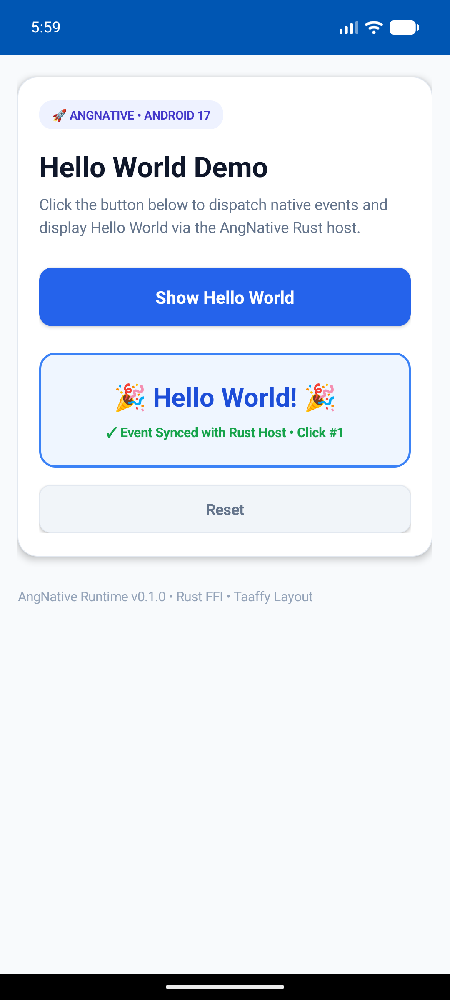

# 🚀 AngNative

<p align="center">
  
</p>

<p align="center">
  <b>The High-Performance Native Mobile & Desktop Runtime for Angular.</b><br/>
  <i>True Native UI widgets. Zero WebViews. Powered by an ultra-fast Rust Host Engine & Taffy Layout.</i>
</p>

<p align="center">
  <a href="https://github.com/moidiqbal/angnative/actions/workflows/ci.yml"></a>
  <a href="https://angular.dev"></a>
  <a href="https://www.rust-lang.org"></a>
  <a href="https://developer.android.com"></a>
  <a href="https://developer.apple.com/ios/"></a>
  <a href="LICENSE"></a>
</p>

---

## ⚡ Why AngNative?

For over a decade, **Angular** has been the enterprise gold standard for web applications. Yet on mobile, developers were forced to compromise: either wrap apps in sluggish **WebViews** (Cordova, Capacitor, Ionic) or abandon TypeScript and Angular altogether for Flutter (Dart) or React Native.

**AngNative eliminates the compromise.**

AngNative executes your Angular components and reactive signals on an embedded JS runtime, synchronizes a high-throughput shadow tree inside an ultra-fast **Rust Host Engine**, computes Flexbox/Grid layouts via **Taffy**, and renders **100% native platform UI widgets** (`android.widget.*`, `UIKit.*`) via C-FFI / JNI bridges. Mutations cross the boundary as JSON batches (zero-copy transport is planned, not yet implemented).

---

## 📸 Live Demo Showcase

The Android shell is a functional Gradle project (API 34) with a hand-built Kotlin demo view. Native view mounting from Rust is still being wired — see [`docs/PROJECT-REVIEW-2026-11-20.md`](docs/PROJECT-REVIEW-2026-11-20.md) for the verified status.

<p align="center">
  <table align="center">
    <tr>
      <th align="center"><b>1. Initial View (Rendered via Rust &amp; Taffy)</b></th>
      <th align="center"><b>2. Button Tap (Synced with Rust Host Shadow Tree)</b></th>
    </tr>
    <tr>
      <td align="center">
        
        <br/>
        <i>Top-aligned Material 3 card, Native text, and Action button</i>
      </td>
      <td align="center">
        
        <br/>
        <i>Interactive bounce animation, click counter &amp; event sync badge</i>
      </td>
    </tr>
  </table>
</p>

---

## 🏛️ System Architecture

```
+-------------------------------------------------------------+
|                      Angular 22+ App                        |
|        (Signals, Zoneless, Dependency Injection, DI)        |
+-------------------------------------------------------------+
                              |
                     @angnative/core
              (Custom Renderer2 & Shadow Tree)
                              |  Batch Mutation Buffer
                              v
+-------------------------------------------------------------+
|                      Rust Host Engine                       |
|   crates/angnative-host-core   |   crates/angnative-host-ffi|
|   crates/angnative-host-layout (Taffy 0.15.1 Flexbox/Grid)   |
|   crates/angnative-host-view   |   crates/angnative-services|
+-------------------------------------------------------------+
                              |
          +-------------------+-------------------+
          | Zero-Copy JNI                         | C-FFI / Swift
          v                                       v
+-----------------------+               +-----------------------+
|    Android Shell      |               |       iOS Shell       |
|  (Native View Hierarchy,              |   (UIKit / Metal UI,  |
|   Material 3 Surface) |               |    Mach-O arm64)      |
+-----------------------+               +-----------------------+
```

---

## ✨ Key Features

- 🎯 **Pure Native Widgets (No WebViews)**: Buttons are real `android.widget.Button` / `UIButton`. Text is real `android.widget.TextView` / `UILabel`. 60–120 FPS buttery smooth scrolling.
- 🦀 **Rust Core Engine**: Ultra-low memory footprint, lightning-fast mutation batching, and strict memory safety.
- 📐 **Taffy 0.15.1 Layout**: High-performance CSS Flexbox & CSS Grid computation directly in Rust before touching the UI thread.
- ⚡ **Angular 22 Ready**: Full support for Angular Signals (`signal()`, `computed()`, `effect()`), modern control flow (`@if`, `@for`), and zoneless change detection (Angular's `provideZonelessChangeDetection()`).
- 🌉 **Zero-Copy FFI**: Fast mutation batch serialization using byte buffers over JNI on Android and direct C-ABI on iOS/Desktop.
- 📱 **Cross-Platform**: Android (API 34 shell), iOS (shell in progress — Mac build verification pending), Desktop (Win32/macOS/Linux, in development), and `@angnative/web` DOM fallback adapter (available).

---

## 🧩 Writing an AngNative Component

Developing with AngNative feels identical to standard modern Angular, using native semantic tags:

```typescript
import { Component, signal } from '@angular/core';
import { NaViewComponent, NaTextComponent, NaButtonComponent } from '@angnative/common';

@Component({
  selector: 'app-counter',
  standalone: true,
  imports: [NaViewComponent, NaTextComponent, NaButtonComponent],
  template: `
    <na-view style="flex-direction: column; padding: 24px; gap: 16px;">
      <na-text style="font-size: 28px; font-weight: bold; color: #1E293B;">
        AngNative Demo
      </na-text>
      
      <na-text style="font-size: 18px; color: #64748B;">
        Clicks: {{ count() }}
      </na-text>

      <na-button 
        (click)="increment()"
        style="background-color: #4F46E5; border-radius: 12px; padding: 14px 20px;">
        <na-text style="color: #FFFFFF; font-weight: 600;">
          Tap Me! 🚀
        </na-text>
      </na-button>
    </na-view>
  `
})
export class CounterComponent {
  count = signal(0);

  increment() {
    this.count.update(c => c + 1);
  }
}
```

---

## 📦 Workspace Architecture

```
angnative/
├── Cargo.toml                    # Rust workspace configuration
├── package.json                  # pnpm monorepo workspace
├── crates/                       # 🦀 Rust Core Crates
│   ├── angnative-host-core/      # Mutation protocol, shadow DOM & element registry
│   ├── angnative-host-engine/    # QuickJS runtime & embedded JS executor
│   ├── angnative-host-ffi/       # C-ABI and JNI bindings with exported C header
│   ├── angnative-host-layout/    # Taffy 0.15.1 Flexbox/Grid adapter & text measurer
│   ├── angnative-host-view/      # View factory, view tree, and op emitter
│   ├── angnative-services-core/  # Capabilities, crypto, diagnostics, and sync
│   └── angnative-desktop/        # Native desktop shell (Windows, macOS, Linux)
├── packages/                     # 🅰️ Angular & TypeScript Packages
│   ├── core/                     # Custom Angular Renderer2 & NativeElement runtime
│   ├── common/                   # Native primitives (<na-view>, <na-text>, <na-button>)
│   ├── contract/                 # Binary mutation protocol schema & event specs
│   ├── platform/                 # Native Angular platform bootstrap
│   ├── cli/                      # CLI tools (init, build, run, doctor, inspect)
│   └── testing/                  # Conformance test suites and mutation teeth
├── platforms/                    # 📱 Native Platform Shells
│   ├── android/                  # Android Studio project, JNI bridge, Kotlin UI runtime
│   └── ios/                      # iOS SwiftPM shell & Darwin SDK toolchain
└── apps/
    └── demo-app/                 # Standalone Angular Native application
```

---

## 🛠️ Quick Start

### Prerequisites
- [Node.js](https://nodejs.org/) v20+ and [pnpm](https://pnpm.io/) v9+
- [Rust](https://rustup.rs/) 1.80+ (`rustup target add aarch64-linux-android x86_64-linux-android`)
- Android Studio / SDK (API 34+) & NDK 26+

### 1. Clone & Install
```bash
git clone https://github.com/moidiqbal/angnative.git
cd angnative

# Install JS dependencies
pnpm install

# Build Rust crates
cargo build --workspace
```

### 2. Run Android Demo App
```bash
# Build Rust host FFI library for Android targets
./scripts/build-android-native.sh

# Open and run platforms/android in Android Studio, or via CLI:
cd platforms/android
./gradlew installDebug
```

---

## 🗺️ Platform Support Matrix

| Platform | Target Runtime | Layout Engine | Status |
| :--- | :--- | :--- | :--- |
| **Android** | Kotlin + Android View Hierarchy / Jetpack | Rust Taffy + JNI | 🟡 Shell builds; Rust→native view wiring in progress (API 34) |
| **iOS** | Swift + UIKit / Metal | Rust Taffy + C-FFI | 🟡 Toolchain & Mach-O arm64 Ready |
| **Desktop** | Win32 / AppKit / Wayland | Rust Taffy + Winit | 🟡 In Development |
| **Web** | `@angnative/web` DOM renderer (Angular 22) | CSS Flexbox / DOM | ✅ Available (`pnpm start`) |

---

## 📖 In-Depth Documentation

Explore the official engineering documentation in the [`docs/`](docs/) directory:
- [Architecture Blueprint](docs/ARCHITECTURE.md) — Comprehensive technical design & FFI specifications
- [Requirements & SLAs](docs/REQUIREMENTS.md) — Functional/non-functional requirements & performance SLAs
- [Technical Specifications](docs/SPECIFICATIONS.md) — Mutation protocol opcodes & supported Taffy CSS styles
- [Android Build Guide](docs/ANDROID-BUILD.md) — Detailed NDK, JNI, and Gradle build instructions
- [Size Budget Policy](docs/R8-SIZE-BUDGET.md) — R8, Proguard, and stripped native binary budgets
- [Project Roadmap](docs/ROADMAP.md) — Phased delivery plan

---

## 🤝 Contributing

Contributions are warmly welcome! Whether you are an Angular expert, a Rustacean, or a mobile platform engineer:

1. Fork the Project
2. Create your Feature Branch (`git checkout -b feature/AmazingFeature`)
3. Commit your Changes (`git commit -m 'feat: add some amazing feature'`)
4. Push to the Branch (`git push origin feature/AmazingFeature`)
5. Open a Pull Request

---

## 📄 License

Distributed under the **MIT License**. See `LICENSE` for more information.

---

<p align="center">
  Built with ❤️ by <a href="https://github.com/moidiqbal">Moid Iqbal</a> and the open-source community.
</p>
