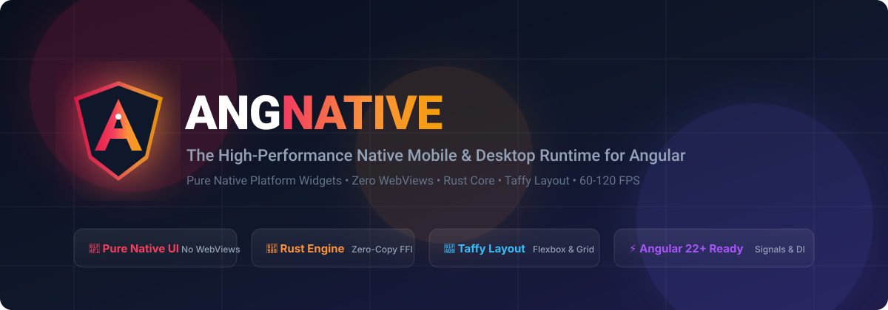

# 🚀 AngNative

<p align="center">
  
</p>

<p align="center">
  <b>The High-Performance Native Mobile & Desktop Runtime for Angular.</b><br/>
  <i>True Native UI widgets. Zero WebViews. Powered by a Rust Host Engine &amp; Taffy Layout.</i>
</p>

<p align="center">
  <a href="https://github.com/moidiqbal/angnative/releases/tag/v0.2.0"></a>
  <a href="https://github.com/moidiqbal/angnative/actions/workflows/ci.yml"></a>
  <a href="https://angular.dev"></a>
  <a href="https://www.rust-lang.org"></a>
  <a href="https://developer.android.com"></a>
  <a href="https://github.com/moidiqbal/angnative/blob/main/LICENSE"></a>
</p>

> **Latest release: [`v0.2.0`](https://github.com/moidiqbal/angnative/releases/tag/v0.2.0)** — Rust core, Angular renderer, Android + desktop + web adapters, production AOT, 10 native showcase APKs, and physical-device benchmarks. iOS shell is code-complete but Mac build verification is still pending.

---

## ⚡ Why AngNative?

Angular developers should not have to choose between WebViews and abandoning TypeScript. AngNative runs a custom Angular `Renderer2` over a Rust host engine: template mutations become `CommandBatch`es, a shadow tree is maintained in Rust, Taffy computes Flexbox/Grid layout, and platform shells render real native widgets via C-FFI/JNI — **no WebView, no DOM, no embedded browser in native mode**.

> Honest note: mutations cross the FFI boundary as JSON batches. Zero-copy transport and a binary protocol are planned, not implemented. A real Angular AOT bundle now boots inside the embedded QuickJS runtime and a native event reaches the Angular listener (see [`docs/CODE-REVIEW-2026-11-22.md`](docs/CODE-REVIEW-2026-11-22.md)); the *shipping* native shells still render Rust/Kotlin-driven trees, so on-device bundle loading is the remaining integration step (see [`docs/EVENT-BRIDGE.md`](docs/EVENT-BRIDGE.md)). Third-party DOM libraries are represented by clearly labelled **native reimplementations** (see [`docs/COMPATIBILITY.md`](docs/COMPATIBILITY.md)).

---

## ✅ Verified status (v0.2.0)

Full evidence: [`docs/VERIFICATION-REPORT.md`](docs/VERIFICATION-REPORT.md) · [`docs/COMPATIBILITY-EVIDENCE.md`](docs/COMPATIBILITY-EVIDENCE.md)

| Component | Status | Proof |
|---|---|---|
| Rust host crates + engine | ✅ | `cargo test --workspace` → **135 passed**; the 9 ignored Angular-in-QuickJS acceptance tests plus 1 third-party RxJS spot-check pass when `dist/aot` bundles are generated |
| Angular renderer / contract / testing | ✅ | `pnpm test` → **221 passed** (16 files) |
| Production AOT (`ngc` + esbuild) | ✅ | `pnpm run compile:aot`, `angnative build`; Ivy `ɵɵdefineComponent` verified in `dist/aot/` |
| Android shell (10 APKs) | ✅ | built, installed and launched on emulator **and OnePlus Open (Android 16)**; `WebViews: 0` on every app |
| Desktop shell (winit + wgpu) | ✅ | 11 tests; window opens; interactive button; shader fix |
| Web adapter (`@angnative/web`) | ✅ | DOM backend + Playwright verified render/click |
| iOS shell | 🟡 bindings statically verified | Swift 6 package + UIKit + runtime bridge bindings; **Mac/Xcode build/test not run** |
| Size budget gate | ✅ | `GATE EXIT=0`, 203 B gzip / 60 KB |

### Performance (real hardware, OnePlus Open, Android 16)

| Benchmark | Emulator (SwiftShader) | OnePlus Open (real GPU) |
|---|---:|---:|
| 10,000-row virtualized grid jank | 16.13% | **1.76%** |
| Grid p50 frame time | 20 ms | **6 ms** |
| Views recycled during scroll test | 177 | **771** |

Reports + screenshots: [`docs/benchmarks/physical/README.md`](docs/benchmarks/physical/README.md), [`docs/BENCHMARKS.md`](docs/BENCHMARKS.md).

---

## 📱 Native showcases

All 10 showcase sources + prebuilt APKs: [`dist/device-testing/`](dist/device-testing/), [`showcases/`](showcases/). Device benchmark numbers (no screenshots) are in [`docs/benchmarks/physical/README.md`](docs/benchmarks/physical/README.md).

---

## 🏛️ System Architecture

```
+-------------------------------------------------------------+
|                      Angular 22+ App                        |
|        (Signals, Zoneless, Dependency Injection)             |
+-------------------------------------------------------------+
                      @angnative/core
              (Custom Renderer2 & Shadow Tree)
                               |  CommandBatch JSON
                               v
+-------------------------------------------------------------+
|                      Rust Host Engine                       |
|  host-core (mutations) | host-view (ops) | host-layout (Taffy 0.15.1)
|  host-ffi (C ABI)      | host-engine (QuickJS) | services-core
+-------------------------------------------------------------+
          | JNI / C-FFI          | C-ABI          | DOM backend
          v                      v                v
+-------------------+  +-------------------+  +-------------------+
| Android shell     |  | iOS / Desktop     |  | @angnative/web    |
| native View tree  |  | UIKit / wgpu      |  | DOM (browser)     |
+-------------------+  +-------------------+  +-------------------+
```

---

## 🧩 Writing an AngNative Component

```typescript
import { Component, signal } from '@angular/core';
import { NaViewComponent, NaTextComponent, NaButtonComponent } from '@angnative/common';

@Component({
  selector: 'app-counter',
  standalone: true,
  imports: [NaViewComponent, NaTextComponent, NaButtonComponent],
  template: `
    <na-view style="flex-direction: column; padding: 24px; gap: 16px;">
      <na-text style="font-size: 28px; font-weight: bold;">AngNative Demo</na-text>
      <na-text style="font-size: 18px;">Clicks: {{ count() }}</na-text>
      <na-button (click)="increment()" style="background-color: #4F46E5; padding: 14px 20px;">
        <na-text style="color: #FFFFFF;">Tap Me! 🚀</na-text>
      </na-button>
    </na-view>
  `
})
export class CounterComponent {
  count = signal(0);
  increment() { this.count.update(c => c + 1); }
}
```

---

## 📦 Workspace

```
angnative/
├── crates/            # Rust host core, layout, view, ffi, engine, services, desktop
├── packages/          # core, common, contract, platform, cli, testing, web, native-ui-core
├── platforms/         # android (JNI + Kotlin), ios (Swift 6 + UIKit)
├── showcases/         # 10 native showcase projects (5 UI + 5 ecosystem)
├── scripts/           # build, verify, benchmark, AOT helpers
├── dist/              # AOT output, size reports, device-testing APKs
└── docs/              # architecture, compatibility, benchmarks, ADRs, tracker
```

---

## 🛠️ Quick start / reproduce

```powershell
# Windows: put Git's patch.exe first on PATH (rquickjs-sys build script)
$env:PATH="C:\Program Files\Git\usr\bin;$env:PATH"

pnpm install
pnpm run compile:aot            # real Angular ngc, Ivy verified
node packages/cli/dist/cli.js build
cargo build --workspace
cargo test --workspace          # 135 tests (+ 9 --ignored Angular acceptance + 1 third-party spot-check)
pnpm test                       # 221 tests
node scripts/check-size-budget.mjs
```

`Cargo.lock` is committed for reproducible Rust builds. Prebuilt Android `.a`
libraries in `jniLibs/` are **not** tracked — regenerate them with
`pwsh -File scripts/build-android-native.ps1` (or `./scripts/build-android-native.sh all`)
before building any Android project.

Run Android demo: `pwsh -File scripts/build-android-stack.ps1 -Stack latest` then `./gradlew assembleDebug` in `platforms/android/` — or install a prebuilt APK from [`dist/device-testing/`](dist/device-testing/).

iOS (requires a Mac):
```bash
./scripts/build-ios-native.sh simulator
cd platforms/ios && swift test -Xlinker -L../../platforms/ios/Sources/AngNativeHost
```

---

## 🍎 Help us finish iOS — sponsors / Mac needed

[](https://github.com/sponsors/moidiqbal)
[](https://opencollective.com/angnative)
· Details & transparency: [`docs/SPONSORS.md`](docs/SPONSORS.md)

The iOS shell is **code-complete** (Swift 6 SwiftPM package, legacy-host + runtime-bridge C ABI bindings with `UInt64` node ids, 8 UIKit view-factory callbacks, demo + tests). `python scripts/check-ffi-declarations.py` statically verifies the bindings and unified staticlib wiring, but we do not have a Mac/Xcode in the current development environment, so no Swift compile or simulator run has happened.

We are looking for:
- **A Mac with Xcode** (even a macOS CI runner or a short loan/test session) to run [`scripts/build-ios-native.sh`](scripts/build-ios-native.sh), `swift test`, and the Simulator demo.
- **Sponsorship** for a macOS mini / GitHub Actions macOS runner / Apple Developer Program so iOS can be verified and released with the same evidence bar as Android.

If you can help, open an issue titled **"iOS Mac verification"** or reach out via the repository. Contributors who provide Mac time will be credited in `docs/CONTRIBUTORS.md` and the release notes.

---

## 📖 Documentation

- [Verification report](docs/VERIFICATION-REPORT.md) — every command and result
- [Compatibility evidence](docs/COMPATIBILITY-EVIDENCE.md) — per-library versions, APIs, tests, limits
- [Library compatibility](docs/COMPATIBILITY.md) and [11-category ecosystem matrix](docs/ECOSYSTEM-COMPATIBILITY.md)
- [Benchmarks](docs/BENCHMARKS.md) + [physical-device results](docs/benchmarks/physical/README.md)
- [Showcase tracker](docs/SHOWCASE-TRACKER.md), [Deliverables index](docs/DELIVERABLES.md), [Unsupported features](docs/UNSUPPORTED-FEATURES.md)
- [Architecture](docs/ARCHITECTURE.md), [Requirements](docs/REQUIREMENTS.md), [Specifications](docs/SPECIFICATIONS.md), [Android build](docs/ANDROID-BUILD.md), [iOS build](docs/IOS-BUILD.md), [Event bridge](docs/EVENT-BRIDGE.md)
- [Framework comparison (NativeScript / React Native / Flutter / Capacitor)](docs/COMPARISON.md) — includes honest gaps and AngNative-only measured numbers
- ADRs: [0001 Taffy](docs/adr/0001-taffy-0151-layout-adapter.md), [0002 Zero WebView](docs/adr/0002-zero-webview-showcases.md), [0003 Labelling](docs/adr/0003-native-reimplementation-labelling.md), [0004 shared native UI core](docs/adr/0004-shared-native-ui-core.md)
- Original review + remediation log: [PROJECT-REVIEW-2026-11-20.md](docs/PROJECT-REVIEW-2026-11-20.md)

---

## 📄 License

MIT — see [`LICENSE`](LICENSE). Third-party libraries referenced in compatibility reports remain under their own licenses; no third-party UI library code is bundled into native showcases.
