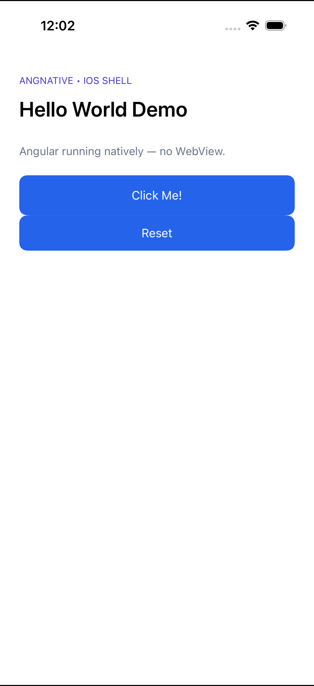

# iOS Simulator verification (first Mac run)

Date: 2026-11-28. First time the iOS shell was compiled, linked, tested and run.

## Environment

| Item | Value |
|---|---|
| Host | Apple silicon Mac (arm64), macOS 26.6.2 |
| Xcode | 27.2 (27B52), Swift 6.4.2 |
| Simulator | iPhone 17 Pro, iOS 26.4 |
| Rust | nightly-2026-11-14 (from `rust-toolchain.toml`) |
| Package minimum | iOS 17.0 |

## Commands and results

```bash
python3 scripts/check-ffi-declarations.py
# FFI declaration check OK: 40 JNI methods across 2 Android shells, 22 Swift bindings
# (13 runtime bridge), 31 header declarations; iOS unified staticlib wiring OK

./scripts/build-ios-native.sh simulator --test
# Rust target : aarch64-apple-ios-sim
# ** TEST BUILD SUCCEEDED **
# Executed 8 tests, with 0 failures (0 unexpected)
# ** TEST EXECUTE SUCCEEDED **

./scripts/build-ios-native.sh device
# Rust target : aarch64-apple-ios
# ** BUILD SUCCEEDED **      (unsigned, generic/platform=iOS)

./scripts/run-ios-simulator.sh docs/assets/ios-simulator-demo.png
# ✓ AngNativeDemo running on 'iPhone 17 Pro'
# [AngNative] nodeCount=7
```

## XCTest suite (iPhone 17 Pro simulator)

| Test | Result |
|---|---|
| `testNativeHostCreation` | ✅ |
| `testBatchProcessing` | ✅ |
| `testNodeCountAndSnapshot` | ✅ |
| `testLayoutComputation` | ✅ |
| `testViewFactoryRegistration` | ✅ |
| `testFactoryBuildsUIKitTreeSynchronously` (new) | ✅ root mounted with 6 children, `UILabel` text and 12 pt font from `"12px"`, `SetTextContent` update reaches the label |
| `testDemoViewControllerButtonUpdatesOutputLabel` (new) | ✅ demo button has its `touchUpInside` action registered; invoking it updates the output `UILabel` to `Hello World!` via Rust |
| `testRuntimeBridgeBootsAngularBundleIntoUIKit` (new) | ✅ see below |

### Angular end to end on iOS

`testRuntimeBridgeBootsAngularBundleIntoUIKit` registers `UIKitViewFactory` on
the runtime bridge's host, loads the AOT counter bundle
(`dist/aot/quickjs-bundle.js` when generated, otherwise the committed copy at
`showcases/ecosystem-core/app/src/main/assets/angnative-bundle.js`) into
QuickJS, then dispatches a native `click`:

```
[AngNative] bundle=angnative-bundle.js nodes=13 views=13 buttons=[10, 11, 12] clicked=10
[AngNative]   label 8: Count: 0 -> Count: -1
[AngNative]   label 13: even -> odd
```

- `loadScript` returned 0, so Angular bootstrapped in QuickJS on iOS.
- 13 host nodes became 13 UIKit views, and `<na-button>` mapped to `UIButton`.
- A click on node 10 invoked exactly one Angular listener (decrement), and the
  signal and `computed` updates reached two `UILabel`s.

## Demo app screenshot



Badge, title, subtitle and both buttons render as UIKit views driven by the
Rust host and Taffy layout.

## Fixes needed to get here

1. `rquickjs-sys` 0.14 has no pregenerated bindings for iOS targets. Enabled
   `bindgen` for `cfg(target_os = "ios")`, the same approach as Android.
2. `swift build` / `swift test` compile for macOS (no UIKit). The build script
   now uses `xcodebuild` with an iOS destination.
3. `DemoViewController.init() throws` cannot override `UIViewController.init()`.
   Replaced it with `DemoViewController.make()`.
4. `UIKitViewFactory` deferred every callback with `DispatchQueue.main.async`,
   so the views did not exist when the demo mounted the root right after
   `processBatch` returned. The screen would have been blank, with the buttons
   unwired. The factory is now `@MainActor` and applies changes synchronously
   (the Rust host calls it synchronously on the caller's thread). This also
   clears the Swift 6 actor-isolation diagnostics.
5. Styles arrive from Rust as strings (`"12px"`), but `fontSize`, `opacity` and
   `cornerRadius` were only applied for `NSNumber`. They are now parsed.
6. QuickJS C objects were built for the SDK's iOS version (27.2) rather than
   17.0. The script exports `IPHONEOS_DEPLOYMENT_TARGET=17.0`.
7. `scripts/*.sh` were committed without the executable bit.

## Not verified

- A physical iPhone (needs signing / a device).
- A real touch through UIKit's event system. Hostless SwiftPM tests have no
  `UIApplication`, so the demo test invokes the registered action directly.
- The demo app still renders the hand-built Rust batch, not the Angular bundle.
  The Angular path is proven by XCTest only.
